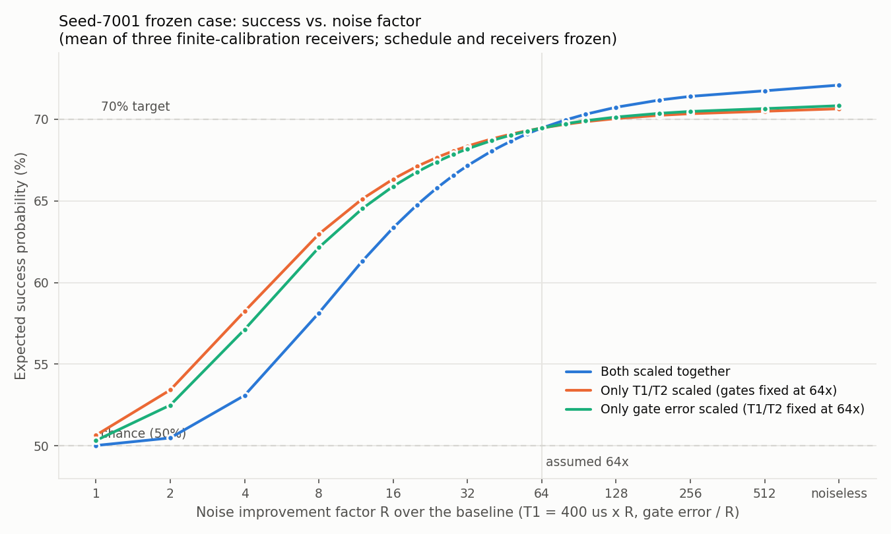

# Noise sweep and scrambling-advantage analysis

Exploratory simulations added on 8 November 2026, written with AI assistance (Claude). Everything here is a noiseless or modelled-noise simulation on a laptop. There is no hardware execution and no external review. These files are **not** in `PUBLIC_MANIFEST.json`, and `VERIFY_PUBLIC.py` does not cover them.

## 1. Noise-factor sweep of the frozen seed-7001 case

`plan-a/REPRODUCE_FULL_CASE.py` assumes noise 64 times better than a baseline of T1 = 400 µs, T2 = 200 µs, and gate depolarizing error of 3e-4 (sx) and 3e-3 (cz). `noise_sweep.py` turns that factor into two parameters, one for T1/T2 and one for gate error. It keeps the 229.46 µs schedule and the receivers frozen. Readout assignment error is not scaled. At R = 64 the sweep reproduces the archived endpoints to within 1e-9.

```text
python -s -E noise_sweep.py ../../plan-a/REPRODUCE_FULL_CASE.py --workers 8
python -s -E plot_sweep.py noise_sweep_results.csv noise_sweep.png
```



The table shows the mean of the three finite-calibration receivers when both factors are scaled together.

| R | 1 | 8 | 32 | 64 | ≈81 | noiseless |
|---|---|---|---|---|---|---|
| success | 50.0% | 58.1% | 67.2% | 69.5% | 70% crossing | 72.1% |

Improving only T1/T2 (gates held at 64x) tops out at 70.6%. Improving only gate error (T1/T2 held at 64x) tops out at 70.8%. Both kinds of noise have to improve.

## 2. Where the noiseless ceiling comes from (`ceiling.py`, `probe_unitary.py`)

In the noiseless limit:

- The 8-qubit state after transport still distinguishes the bit perfectly (Helstrom bound 100%).
- The right 4 qubits reach only **73.8%**, which is the bound for any possible receiver.
- The oracle receiver without readout error already achieves 73.8%, so the receiver is optimal.
- Readout error costs about 0.7 points and finite calibration about 1 point.
- The dominant loss is the transport dynamics. `probe_unitary.py` rebuilds the schedule's noiseless 8-qubit unitary and checks it against the noiseless transport (agreement to 2e-15).

## 3. Raw success is not a meaningful target (`fit_protocol.py`, `family_ceiling.py`, `scrambling_advantage.py`)

`fit_protocol.py` shows that the frozen schedule is not of the simple form F(t2)·exp(iμV)·F(t1), so its effective μ is unknown. Within that protocol family, built from the same H and V that `source()` uses, the right-side bound reaches **100% at μ = π/2 even with H = 0**. At that coupling, exp(iμV) acts as a swap of the left and right Majoranas, so no scrambling is needed. With H = 0 the success is exactly 1/2 + 1/2·sin²μ. That curve gives 73.7% at μ ≈ 0.76, which matches the frozen schedule's noiseless 73.8%.

The quantity worth reporting is therefore the margin of SYK over non-scrambling controls at the same settings.

## 4. Scrambling advantage across all 12 seeds (`advantage_seeds.py`, `edge_run.py`)

In this analysis the control Hamiltonian replaces H in the whole protocol, including TFD preparation, insertion and transport. Two controls are used: H = 0, and a random quadratic SYK2 with the same Frobenius norm. Both give identical results everywhere. Success is the right-side Helstrom bound, optimized over t1 (t2 is local and cannot change it). `python advantage_seeds.py check <REPRODUCE_FULL_CASE.py>` confirms that the re-implemented `source()` equals the repository's output exactly.

| setting | SYK4 | control | advantage mean | advantage worst seed |
|---|---|---|---|---|
| repository default: β = 4, t_ins = 1, μ = 0.3 | 61.0% | 54.4% | +6.7 | +4.1 |
| repository default: β = 4, t_ins = 1, μ = 0.7 | 71.8% | 70.8% | +1.0 | 0.0 |
| **β ≈ 0.5, t_ins = 0.25, μ = 0.3** | **63.5%** | **54.4%** | **+9.2** | **+7.3** |

- The advantage is positive for all 12 seeds at μ ≤ 0.5. It vanishes near the 70% regime.
- At the tuned point the per-seed advantage ranges from +7.3 to +11.1 points.
- The asymmetry between the two coupling signs stays small (mean below 1.2 points).
- The optimum lies in the high-temperature regime (β ≤ 1 gives the same result). That regime corresponds to scrambling-assisted transfer by operator spreading, not to a low-temperature gravitational picture.

Commands:

```text
python -s -E advantage_seeds.py seeds seeds.jsonl
python -s -E advantage_seeds.py tune tune03.jsonl 0.3
python -s -E edge_run.py            # writes edge.jsonl
```

## Limits

- Sections 3 and 4 are noiseless and assume the optimal (Helstrom) receiver.
- The transport family in sections 3 and 4 is a model built for this analysis, not the frozen schedule.
- Time parameters were searched over a bounded range ([-6, 6] for t1 in section 4).
- Whether a 9-point advantage survives realistic noise requires compiling the new protocol. That has not been done.
- Section 1 covers only seed 7001, because it is the only seed with a public frozen schedule.

Code and data follow the terms in `LICENSES.md` (MIT for code, CC BY 4.0 for generated data).
